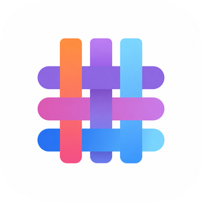
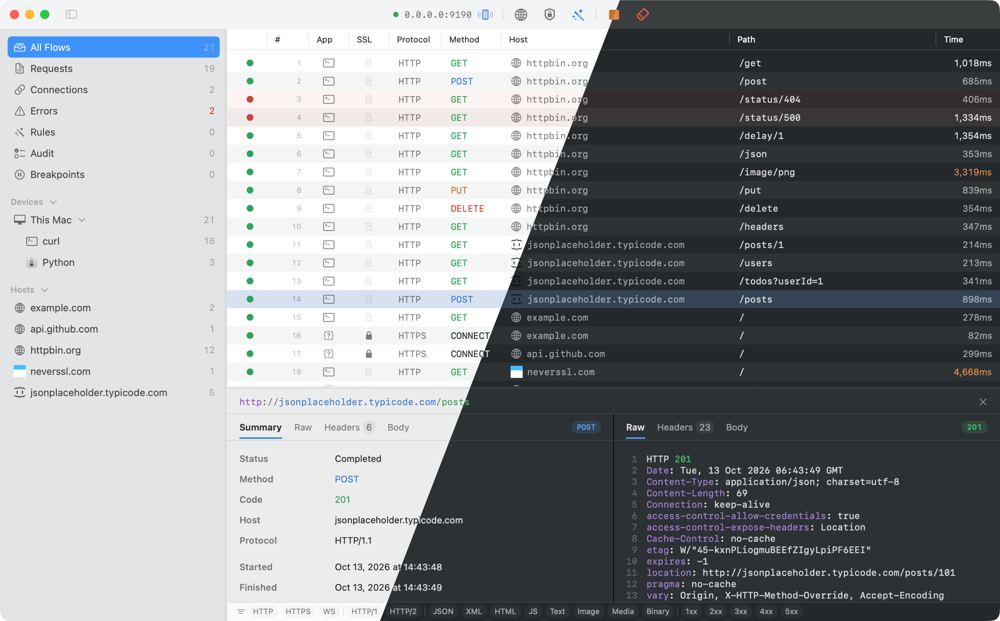

<p align="center">
  
</p>

# Loom

[English](README.md) | **简体中文**

<p align="center">
  
</p>

一个常驻状态栏的 **AI 可操作 HTTP/HTTPS 调试代理**(macOS)。它像 Charles/Proxyman
一样抓包,但主要的操作者是通过 **MCP** 对话的 AI Agent——而且 MCP 暴露的是**写操作**
(重放、规则),不只是只读查询。Agent 由此闭合调试环(抓包 → 改写 → 重放 → 对比),
你则从菜单栏面板监督。

## 安装 App

Loom 的工具由运行中的 App 提供,Agent skill 也随 App 一起分发。从
[最新 release](https://github.com/KQAR/Loom/releases/latest) 下载 `Loom.dmg`,
或按下文自行构建。

> **首次启动需要右键 → 打开。** Release 是 ad-hoc 签名,没有 Developer ID 证书,
> 所以直接双击会被 Gatekeeper 拦下。这是既定选择而非缺陷:更新的真实性由 Sparkle
> 的 EdDSA 签名保证。之后启动一切照常。

## 连接 Agent(Claude Code / Cursor)

Agent skill 随 App 一起分发。最省事的做法:选 **Loom ▸ Copy Agent Setup Prompt**,
粘贴给 Agent,让它自己完成安装。也可以手动执行一次:

```bash
sh /Applications/Loom.app/Contents/Resources/install-agent.sh          # Claude Code
sh /Applications/Loom.app/Contents/Resources/install-agent.sh cursor   # Cursor
```

它把 App 内置的 `loom` skill 符号链接到 Agent 的 skills 目录,并注册
`http://127.0.0.1:9092/mcp` 这个 MCP 服务。skill 是指向 App 内部的链接,所以**更新 Loom
就等于更新 skill**,无需重新安装(装过旧的 `loom@loom` 插件也会顺手卸掉)。然后启动 Loom 并重启 Agent。

## 通过 MCP 使用

先让客户端走代理(`curl -x http://127.0.0.1:9090 …`、macOS 系统代理,或同一 Wi-Fi 下
的手机扫面板二维码),再由 Agent 驱动。只认 `ALL_PROXY` 的客户端走高一个端口的
**SOCKS5** 监听(`socks5://127.0.0.1:9091`);完全无视代理设置的(Node 的全局 `fetch`)
则用**反向代理端点**——一个替某个上游站点接管的本地端口(`create_reverse_proxy`)。

- **读** — `get_recent_flows`、`get_flow_detail`、`list_devices`、`list_rules` …
- **写** — `replay_flow`(带改写重放)、`set_rule`(mock / 映射 / 改写 / 拦截 / 延迟)、
  `arm_breakpoint` + `resume`(中途挂住流量并改写)、`set_ssl_scope`、
  `import_har` / `export_har` …
- **阻塞等待,不要轮询** — `wait_for_flow` / `wait_for_pending` 会一直等到你触发的
  流量真正到达。

若工具连不上,说明 Loom App 没有运行——启动它即可。

## 从源码构建

需要 [Tuist](https://tuist.io)(版本锁定在 `mise.toml`)和 Xcode(macOS 15+)。

```bash
tuist install                 # 解析 SPM 依赖
tuist generate                # 生成 Loom.xcworkspace
tuist xcodebuild -workspace Loom.xcworkspace -scheme Loom \
  -configuration Debug -destination 'platform=macOS' build
```

`-workspace` 是必需的:只给 `-scheme` 时 xcodebuild 会选错 project,导致 SPM 模块解析失败。

## 许可证

MIT —— 见 [LICENSE](LICENSE)。
